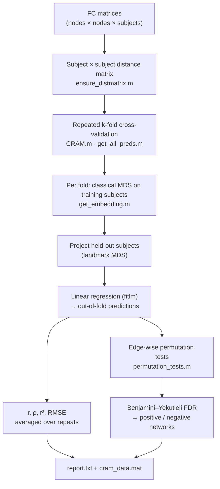

# CRAM: Connectome Regression in Alternate Metrics

CRAM is a MATLAB toolkit that predicts a behavioral or clinical outcome from functional-connectivity (FC) matrices. It treats each subject's whole connectome as one point in a metric space instead of selecting individual edges, as Connectome-based Predictive Modeling (CPM) does. CRAM:

1. measures the distance between every pair of subjects' FC matrices under a chosen metric (Bures–Wasserstein, matrix-root, Euclidean, and others),
2. embeds the subjects in a low-dimensional Euclidean space with multidimensional scaling (MDS),
3. regresses the outcome on that embedding with repeated k-fold cross-validation, and
4. can also recover the edges that drive the predictions, using permutation tests with FDR control.

A standard CPM implementation is included as a baseline. It runs through the same interface when you select `metric.CPM`.

## How it works



### 1. Distance matrix

`ensure_distmatrix.m` builds an m × m matrix that holds the distance between every pair of subjects' FC matrices, using the metric in `mtrc` (see [Distance metrics](#distance-metrics)). The matrix is saved to `cram_data.mat` and reused on later runs.

### 2. Embedding and dimension selection

`get_embedding.m` runs classical MDS (`cmdscale`). The embedding dimension is the index of the last eigenvalue that is larger than the mean eigenvalue. The `Best dimension` in the report is computed on the full sample. During cross-validation, the dimension is chosen again from each fold's training subjects only, so the test fold never influences it.

### 3. Cross-validated regression

Each of the `cv_repeats` repeats runs in a `parfor` loop and splits the subjects into `cv_folds` folds. For each fold, `get_all_preds.m`:

- embeds the training subjects with classical MDS,
- places the held-out subjects in the same coordinates with the landmark-MDS projection, using the training subjects as landmarks (this needs only the distances from test subjects to training subjects),
- fits an ordinary least-squares model (`fitlm`) on the training embedding and predicts the held-out outcomes.

The out-of-fold predictions for all subjects are scored against the observed outcomes with Pearson r, Spearman ρ, r², and RMSE. Each score is averaged across repeats, and its standard error is printed to the console.

### 4. Network recovery (optional)

When `extract_networks` is true and the metric is not CPM, `permutation_tests.m`:

- correlates every edge (Fisher z) with the model's out-of-fold predictions,
- reruns the full cross-validated prediction `perm_repeats` times on shuffled outcomes, which builds a null distribution for each edge's correlation,
- computes two-sided permutation p-values, counting ties as half,
- applies Benjamini–Yekutieli FDR at `p_thresh` (when `use_fdr` is true),
- splits the significant edges by sign into `pos_net` and `neg_net`, two symmetric n × n binary masks.

The permuted runs also produce `p_regression`, the share of permutations that score above the observed cross-validated r.

### CPM baseline

With `mtrc = metric.CPM`, steps 1 and 2 are skipped. Each cross-validation repeat runs `cpm_main.m` instead, which:

- selects edges at `p_thresh`,
- sums the positive edges minus the negative edges into one summary score per subject,
- fits that score to the outcome with `robustfit`.

In this mode, `pos_net` and `neg_net` are consensus masks: they contain only the edges selected in every fold of every repeat.

## Requirements

- **MATLAB.** R2020b or newer is recommended, because some helpers use `pagemtimes`.
- **Statistics and Machine Learning Toolbox.** The code uses `cmdscale`, `cvpartition`, `fitlm`, `corr`, `robustfit`, `kmeans`, `datasample`, and `bayesopt`.
- **Parallel Computing Toolbox.** Cross-validation repeats, distance computations, and permutations all run in `parfor` loops. `permutation_tests.m` also calls `parpool` if no pool is open.

There is nothing to install. Add the folder to your MATLAB path:

```matlab
addpath("path/to/CRAM");
```

## Quick start

```matlab
% x: nodes × nodes × subjects array of FC matrices
% y: vector of outcomes, one per subject

f = "outputs/my_analysis";          % one folder per dataset / metric / outcome

session = cram_data.load(f);        % resumes from f/cram_data.mat if it exists
session.folder           = f;
session.dataset          = "my_dataset";
session.target           = "my_outcome";
session.mats             = x;
session.outcomes         = y(:);
session.mtrc             = metric.Wasserstein;

session.cv_folds         = 10;
session.cv_repeats       = 100;
session.extract_networks = true;
session.perm_repeats     = 1000;
session.p_thresh         = 0.05;
session.use_fdr          = true;

CRAM(session);
```

When the run finishes, `outputs/my_analysis` contains `report.txt` and `cram_data.mat`, and the report is also printed to the console. `cram_data` is a handle class, so `session` is updated in place and results such as `session.best_r` and `session.pos_net` are available right away.

> The code names this object `cd` internally. That name shadows MATLAB's built-in `cd` command inside those functions, but any variable name works.

## Input data

| Field | Shape | Notes |
|---|---|---|
| `mats` | n × n × m | One symmetric FC matrix per subject (n nodes, m subjects). Must not contain NaN or Inf. |
| `outcomes` | m × 1 | One outcome per subject, in the same order as `mats`. Remove subjects with missing values first. |

Matrices can hold raw Pearson correlations or Fisher z-values. Each metric converts them to the form it needs with `ensure_fisher_transform.m`, which detects the format from the first diagonal element, `mats(1,1,1)`:

- **`1`:** raw correlations.
- **A large value whose `tanh` is within 0.01 of 1** (for example `atanh(0.99999)`): Fisher z.

Any other value stops the run, so set the diagonal consistently before you call `CRAM`. `load_fc_data.m` sets it to `atanh(0.99999)`.

## Configuration

A `cram_data` object holds the inputs, settings, and results of one session. `cram_data.load(folder)` returns the saved object from `folder/cram_data.mat` if that file exists; otherwise it returns a new object with the defaults below.

### Settings

| Property | Default | Description |
|---|---|---|
| `folder` | — | Output directory. It is created if it doesn't exist. |
| `dataset` | — | Dataset label, used in console output and the report. |
| `target` | — | Name of the outcome variable. |
| `mats` | — | n × n × m array of FC matrices. |
| `outcomes` | — | m × 1 outcome vector. |
| `mtrc` | — | A `metric` enumeration value. |
| `cv_folds` | `10` | Folds per cross-validation repeat. |
| `cv_repeats` | `100` | Number of cross-validation repeats. |
| `extract_networks` | `true` | Run permutation tests to recover predictive edges. Ignored for CPM. |
| `perm_repeats` | `1000` | Number of permutations. `0` skips network recovery. |
| `p_thresh` | `0.05` | Significance level for network edges. It is also CPM's edge-selection threshold. |
| `use_fdr` | `true` | Apply Benjamini–Yekutieli FDR to the edge p-values. |
| `wass_dim` | `0` | Rank k for `metric.Wasserstein_n`. `0` means full rank. |
| `mfp_exponent` | — | Exponent p for `metric.Matrix_Fractional_Power_Norm`. |
| `limit` | `0` | Subject cap that `main.m` applies when it loads data (`0` means all subjects). `CRAM` itself ignores it. |

### Results

| Property | Description |
|---|---|
| `distmatrix` | m × m subject distance matrix. Not set for CPM. |
| `best_dim` | MDS dimension selected on the full sample. |
| `best_r`, `best_rho` | Mean cross-validated Pearson r and Spearman ρ. |
| `best_cod` | Mean of r² (the squared Pearson r, not 1 − SS_res/SS_tot). |
| `best_rmse` | Mean root-mean-square error. |
| `perm_rs` | Spearman ρ of each permutation's predictions. |
| `p_regression` | Share of permutations whose ρ is larger than `best_r`. |
| `pos_net`, `neg_net` | n × n binary masks of the edges positively or negatively related to the predictions. |
| `sig_pos_edges`, `sig_neg_edges` | Number of unique edges in each mask. |
| `total_time` | Wall-clock seconds for the session. |

The main pipeline doesn't set the remaining properties (`most_predictive_vectors`, `canonical_clusters`, `roimap`, `network_shrinkage_coef`, and others). They exist for the experimental predictive-vector code.

## Distance metrics

The `metric` enumeration in `metric.m` lists the available options. For two subjects with FC matrices A and B:

| `metric.` | Distance | Input form |
|---|---|---|
| `Euclidean` | ‖A − B‖₂ over all matrix entries | Fisher z |
| `Manhattan` | sum of \|A − B\| | Fisher z |
| `Chebychev` | max of \|A − B\| | Fisher z |
| `Angular` | Angle between the upper-triangle edge vectors | Fisher z |
| `Wasserstein` | Bures–Wasserstein: √(tr A + tr B − 2 tr (A^½ B A^½)^½) | Raw r |
| `Wasserstein_n` | Bures–Wasserstein between rank-k approximations (k = `wass_dim`) | Raw r |
| `Matrix_Root_Norm` | ‖A^½ − B^½‖_F, with negative eigenvalues clipped to 0 | Raw r |
| `Signed_Matrix_Root_Norm` | ‖A^♯ − B^♯‖_F, where A^♯ = V·sign(Λ)·\|Λ\|^½·Vᵀ. Defined for matrices that aren't positive semidefinite. | Raw r |
| `Matrix_Fractional_Power_Norm` | ‖A^p − B^p‖_F, where p = `mfp_exponent` | Raw r |
| `Euclidean_Squared`, `Wasserstein_Squared`, `Matrix_Root_Norm_Squared` | The square of the matching distance | As above |
| `CPM` | Not a metric. Runs Connectome-based Predictive Modeling instead. | As supplied |

`metric.calculateDistance(A, B, m)` computes one pairwise distance for the non-squared Euclidean, Manhattan, Chebychev, Angular, Wasserstein, and matrix-root metrics. It's handy for spot checks.

## Outputs

Each session writes two files to `folder`.

**`report.txt`** summarizes the settings and results:

```
CRAM Session Report
    ----
Destination folder: ...
Elapsed time: ... seconds
Completion time: yyyy/mm/dd HH:MM
Dataset: ...
Metric: ...
Dimension of matrix array: n n m
Best dimension: ...
R at best dimension: ...
Rho at best dimension: ...
Coefficient of Determination at best dimension: ...
RMSE at best dimension: ...
P-value for regression at best dimension: ...
Cross-validation folds: ...
Cross-validation repeats: ...
Permutation count: ...
FDR used?: ...
Threshold: ...
Positive edges found: ...
Negative edges found: ...
```

**`cram_data.mat`** holds the full `cram_data` object, stored as the variable `obj`. That includes the input matrices, the distance matrix, and the network masks. To reload it, call `cram_data.load(folder)`; the `cram_data` class must be on the MATLAB path.

### Re-running in an existing folder

- **Intermediate saves.** The session is saved after the distance matrix is built and again after cross-validation. If a long run fails during permutation testing, the distance matrix is not lost.
- **Distance-matrix cache.** A cached distance matrix is reused as long as its size matches the number of subjects. This check ignores the metric, so give each metric its own output folder (as `main.m` does) or clear `distmatrix` before you switch metrics.
- **Always recomputed.** Cross-validated performance and the permutation tests run again on every call.

## Batch runs with `main.m`

`main.m` is the driver script for the project's own analyses. It calls `CRAM` once for every combination of dataset, outcome, and metric. To choose what runs, edit these local functions:

| Function | Controls |
|---|---|
| `ds()` | Datasets to analyze: PNC, HCP, ABCD, IMAGEN, BARCS, and others. Most are commented out. |
| `hcp_outcomes()` | HCP outcome columns. The default is `PMAT24_A_CR` (fluid intelligence). |
| `metrics()` | Metrics to compare. |
| `cv_folds()`, `cv_repeats()`, `perm_repeats()`, `p_thresh()`, `use_fdr()`, `extract_networks()`, `limit()` | Session settings. |

Results are written relative to the working directory:

- `../outputs/CRAM/<dataset>/<metric>/` for CRAM metrics,
- `../outputs/CRAM/<dataset>/Wasserstein_<k>/` for low-rank Wasserstein,
- `../outputs/CPM/<dataset>/` for the CPM baseline.

`main.m` depends on data under `../data/` and on a `datasets` enumeration, and neither is part of this repository. Treat the script as a template. For new data, the [Quick start](#quick-start) pattern is all you need. A commented-out block at the top of the file sweeps `Wasserstein_n` across a range of ranks.

## Repository layout

### Core pipeline

| File | Purpose |
|---|---|
| `CRAM.m` | Entry point. Runs one session end to end and writes the report. |
| `cram_data.m` | Session object: settings, results, save and load. |
| `metric.m` | Metric enumeration and a pairwise distance helper. |
| `ensure_distmatrix.m` | Computes and caches the subject × subject distance matrix. |
| `get_embedding.m` | Classical MDS and selection of the embedding dimension. |
| `get_all_preds.m` | Cross-validated predictions: MDS, landmark projection, and `fitlm`, or CPM. |
| `permutation_tests.m` | Edge-level permutation tests, FDR, and network masks. |
| `main.m` | Batch driver for the project's datasets. |

### CPM baseline

Adapted from Shen et al. (2017).

| File | Purpose |
|---|---|
| `cpm_main.m` | CPM entry point: argument parsing, input checks, and performance. |
| `cpm_cv.m` | k-fold CPM with consensus masks and optional outcome-stratified folds. |
| `cpm_train.m` | Edge selection and a `robustfit` of the outcome on the summary score. |
| `cpm_test.m` | Applies a trained CPM model to new subjects. |
| `cpm_check_errors.m` | Validates inputs and flattens n × n × m data to edges × subjects. |

### Linear algebra and data utilities

| File | Purpose |
|---|---|
| `rsqrtm.m` | Real, symmetric matrix square root by eigendecomposition, with an optional signed version. |
| `ensure_fisher_transform.m` | Converts between raw correlations and Fisher z. |
| `get_fractional_matrix_powers.m` | Applies A^p to every matrix in a nodes × nodes × subjects × tasks array. |
| `reinflate_mask.m` | Turns an upper-triangle vector back into a symmetric n × n matrix. |
| `load_fc_data.m` | Loads the STP, HCP, and ABCD data. Its paths are specific to the original machine. |
| `load_canonical_clusters.m` | Reads node-to-network labels from `roimap.csv`. |

### Experimental: node-level predictive vectors

These files are not called by the main pipeline.

| File | Purpose |
|---|---|
| `get_predictive_vector.m` | Principal mode of the edge–prediction covariance matrix, shrunk toward canonical-network means and data-driven cluster means. |
| `get_predictive_vector_gd_corr.m` | Finds the unit vector v that maximizes corr(vᵀAᵢv, ŷ), using gradient ascent with momentum and network-mean shrinkage. |
| `best_graph_clusters.m` | Spectral clustering of a signed graph, choosing the number of clusters by signed modularity. |
| `solve_pv_shrinkage.m` | Grid search for the shrinkage strength, scored by bootstrap stability. |
| `solve_pv_shrinkage_bayesian.m` | Bayesian optimization (`bayesopt`) of the two shrinkage weights. |

The `*.asv` files are MATLAB editor autosaves. You can delete them.

## Citation

When using this code, please cite the author:

> Riley, Steve, et al. "Is the whole more than the sum of its parts? Considering global and local features of the connectome improves prediction of individuals and phenotypes." Imaging Neuroscience 4 (2026): IMAG-a.

If you use the CPM baseline, please also cite:

> Shen, Xilin, et al. "Using connectome-based predictive modeling to predict individual behavior from brain connectivity." nature protocols 12.3 (2017): 506-518.

Methods used in the pipeline:

- de Silva, V., & Tenenbaum, J. B. (2004). *Sparse multidimensional scaling using landmark points.* Technical report, Stanford University. Used for the out-of-sample MDS projection.
- Benjamini, Y., & Yekutieli, D. (2001). The control of the false discovery rate in multiple testing under dependency. *Annals of Statistics*, 29(4), 1165–1188. Used for the FDR correction.

## License

This code is released under [CC0 1.0 Universal](LICENSE), a public-domain dedication.
